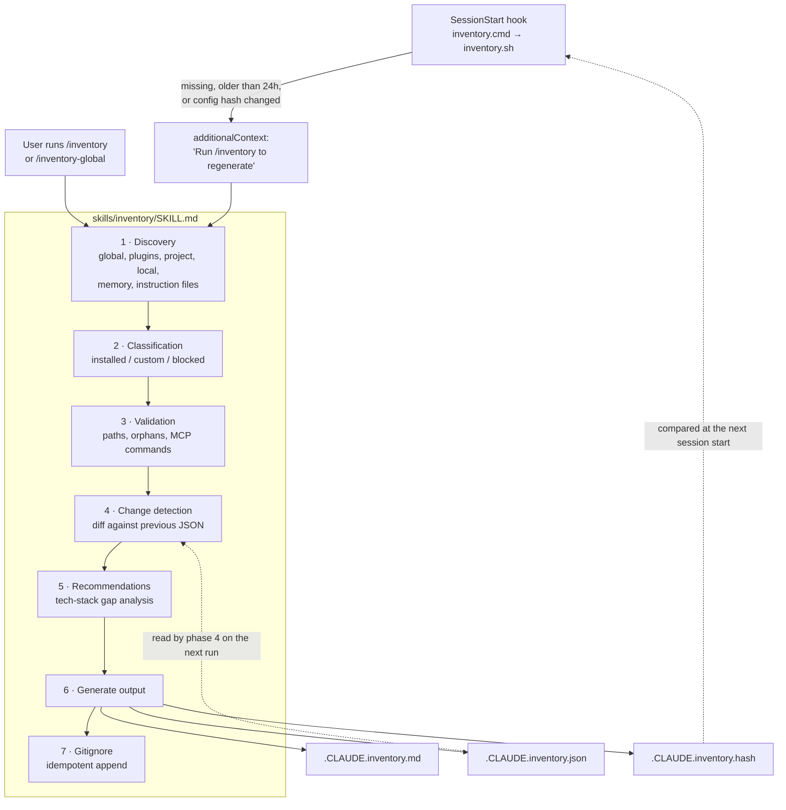

# claude-code-inventory

**One file that answers "what is Claude Code actually running in this repo?"** A Claude Code plugin that finds every hook, skill, plugin, agent, MCP server, memory file and instruction file across all scopes. It tags each item as `installed`, `custom` or `blocked` and writes a single scannable inventory with a JSON sidecar. A session hook tells you when that inventory goes stale.

[](.claude-plugin/plugin.json)
[](LICENSE)
[](https://code.claude.com/docs/en/plugins)
[](#tech-stack)

---

## The problem

Claude Code automations pile up quickly, and they are spread across many places: user settings, the plugin registry and blocklist, each plugin's install directory, project `.claude/` folders, local overrides, per-project memory, and a `CLAUDE.md` / `AGENTS.md` chain that runs from your home directory down into subfolders. After a few weeks of installing plugins and writing skills, nobody can say for sure:

- which hooks fire on `SessionStart`, and in what order;
- which skills came from a marketplace and which ones you wrote;
- whether a plugin you enabled is actually installed, or orphaned on disk;
- whether Claude Code is reading your `AGENTS.md`, or ignoring it because a `CLAUDE.md` exists further up the tree.

## What you get

Run `/inventory` and you get `.CLAUDE.inventory.md` at the project root, grouped by scope. Here is a shortened excerpt from [`examples/sample-output.md`](examples/sample-output.md):

```markdown
# Claude Code Automation Inventory
> Auto-generated by `inventory` plugin — 2026-03-20
> Regenerate: `/inventory`

## Global Scope (`~/.claude/`)
### Hooks
| Event        | Command                     | Origin                  | Description                                  |
|--------------|-----------------------------|-------------------------|----------------------------------------------|
| SessionStart | add-claude-gitignore.cmd    | custom                  | Add .claude/ and CLAUDE.md to .gitignore     |
| SessionStart | run-hook.cmd session-start  | installed (superpowers) | Superpowers session initialization           |
| SessionStart | inventory.cmd               | custom (inventory)      | Check if automation inventory needs regeneration |

### Blocked Plugins
| Plugin                   | Reason   |
|--------------------------|----------|
| fizz@testmkt-marketplace | security |

## Project Scope (`.claude/`)
### MCP Servers
| Name     | Type | Package/URL                         | Origin                    |
|----------|------|-------------------------------------|---------------------------|
| context7 | npx  | @upwind-media/context7-mcp@latest   | custom                    |
| github   | npx  | @modelcontextprotocol/server-github | installed (github plugin) |

## Instruction Files
Mode: `claude-md-or-agents-md` (default)
| Path                     | File      | Lines | Scope        | Status    |
|--------------------------|-----------|-------|--------------|-----------|
| ~/.claude/CLAUDE.md      | CLAUDE.md | 18    | global       | active    |
| ./AGENTS.md              | AGENTS.md | 124   | project root | active    |
| ./services/api/AGENTS.md | AGENTS.md | 31    | subdirectory | on demand |

Score: 7/8 criteria met
```

You also get `.CLAUDE.inventory.json`, a versioned, machine-readable copy of the same data, and `.CLAUDE.inventory.hash`, which lets the hook check freshness cheaply. All three are added to `.gitignore` for you.

## Features

| Area | What it reports |
|------|-----------------|
| **Core inventory** | Hooks, skills, plugins, agents, slash commands and MCP servers, each tagged `installed` / `custom` / `blocked` |
| **Plugin-bundled content** | Skills, agents, commands and `hooks/hooks.json` found inside each enabled plugin's install directory |
| **Hook execution order** | A sequence number per event: global hooks first, then plugin hooks, then project hooks |
| **Instruction files** | The full `CLAUDE.md` / `AGENTS.md` / `CLAUDE.local.md` hierarchy (global, ancestors, root, and subdirectories up to 3 levels deep). Each file is marked `active`, `on demand` or `inactive`, with the reason |
| **Quality score** | An 8-point check of the root instruction file Claude Code actually loads: dev commands, architecture, gotchas, setup, conventions, deployment, key paths, length |
| **Plugin health** | Orphaned versions with their disk usage, plugins that are enabled but not installed, and plugins not updated in 30+ days |
| **Settings conflicts** | Keys set in more than one of global, project and local settings, with the value that wins |
| **Capabilities** | MCP servers loaded eagerly vs. deferred, the deferred tool list (via Tool Search), `Monitor` / `run_in_background` usage, and sandbox and permission-bypass status |
| **Memory and scheduling** | Per-project memory files, with checks for files missing from `MEMORY.md` and broken links in it; local and remote scheduled tasks; MCP servers that need re-auth; keybindings |
| **Change tracking** | A "Recent Changes" diff against the previous JSON snapshot |
| **Validation** | `[!]` warnings for missing hook scripts, missing plugin directories, unavailable MCP commands, and ignored `AGENTS.md` files |
| **Recommendations** | 3–5 automations you don't have yet, based on `package.json` / `pyproject.toml`, Docker files, and similar signals |
| **Cross-project view** | `/inventory-compare` puts every project in one matrix and flags inconsistencies |

## How it works

The plugin has two moving parts. A **SessionStart hook** written in plain Bash only *detects* staleness: it never calls the model and never writes files. A **skill** ([`skills/inventory/SKILL.md`](skills/inventory/SKILL.md)) is an 855-line structured spec that Claude follows in seven phases.



### Scopes and precedence

| Scope | Location | What is read | Precedence |
|-------|----------|--------------|------------|
| **Global** | `~/.claude/` | `settings.json` (hooks, `enabledPlugins`, `effortLevel`, sandbox keys, `instructionFiles` mode), `plugins/installed_plugins.json`, `plugins/blocklist.json`, `skills/*/SKILL.md`, `keybindings.json`, `mcp-needs-auth-cache.json`, `scheduled-tasks/*/`, `CLAUDE.md` | Lowest for settings. Its hooks run first |
| **Plugin-bundled** | Install path from `installed_plugins.json` | `skills/`, `agents/`, `commands/`, `hooks/hooks.json`, `.orphaned_at` markers | Hooks run after global hooks, in `enabledPlugins` order |
| **Project** | `.claude/` | `settings.json` (hooks with matchers, `mcpServers`), `skills/*/SKILL.md`, `agents/*.md` | Overrides global settings. Its hooks run last |
| **Local** | `.claude/settings.local.json` | The **count** of `permissions.allow` entries only. The entries themselves are never listed | Highest (local > project > global) |
| **Memory** | `~/.claude/projects/<slug>/memory/` | `MEMORY.md` index and frontmatter of each memory file | Not applicable |
| **Instructions** | Global, every ancestor directory, project root, subdirectories (≤ 3 levels) | `CLAUDE.md`, `.claude/CLAUDE.md`, `CLAUDE.local.md`, `AGENTS.md`, `.claude/AGENTS.md` | Set by the `instructionFiles` mode (see below) |

Managed (enterprise) settings and `--settings` overrides are **not** read.

### Classification rules

| Item | Tag |
|------|-----|
| Plugin key ending in `@local` | `custom` |
| Plugin key from any other marketplace (e.g. `@claude-plugins-official`) | `installed` |
| Skill, agent, command or hook inside a plugin's install directory | Same tag as its plugin |
| Skills in `~/.claude/skills/` or `.claude/skills/`, agents in `.claude/agents/`, hooks in any `settings.json` | `custom` |
| MCP server in project settings | `custom`, or `installed` when it is known to come from a plugin |
| Plugin listed in `plugins/blocklist.json` | `blocked` |

### Staleness detection

[`hooks/inventory.sh`](hooks/inventory.sh) is a short Bash script with no model call. It runs a cascade of checks and stops at the first one that hits:

1. **Missing:** `.CLAUDE.inventory.md` does not exist.
2. **Age:** the file is older than 24 hours. The script uses `stat -f %m` on macOS and `stat -c %Y` on Linux and Git Bash.
3. **Config hash:** [`hooks/inventory-hash.sh`](hooks/inventory-hash.sh) computes an MD5 (`md5sum`, or `md5 -q` on macOS) over user and project settings, the plugin registry, and listings of skill directories, memory files, scheduled tasks and orphan markers. It is compared with `.CLAUDE.inventory.hash`. This catches a plugin install even when the inventory is only seconds old. The skill writes the stored hash with the same script, and its Python fallback is byte-identical, so the two sides cannot drift apart. [`tests/hash-parity.sh`](tests/hash-parity.sh) enforces that.

When a check hits, the hook prints a `hookSpecificOutput.additionalContext` message and Claude suggests regenerating. Regeneration stays a decision for the user or the model, never a side effect. On Windows, [`hooks/inventory.cmd`](hooks/inventory.cmd) is a polyglot: `cmd.exe` reads it as a batch file that starts Git Bash, while Bash treats the batch block as an ignored heredoc and `exec`s the script.

### Instruction-file activation (v2.2)

Claude Code v2.1.277+ can read `AGENTS.md` in place of `CLAUDE.md`. The skill applies [the documented loader rules](https://code.claude.com/docs/en/memory#agents-md) so the inventory shows what actually loads:

| `instructionFiles` mode | Root/ancestor `CLAUDE.md` family | Root/ancestor `AGENTS.md` |
|-------------------------|-------------------------------|---------------------------|
| `claude-md-or-agents-md` (default) | active | active only if no `CLAUDE.md`-family file exists, otherwise inactive ("CLAUDE.md present") |
| `claude-md-and-agents-md` | active | active |
| `claude-md` | active | inactive |
| `managed-only` | inactive | inactive |

On top of this table, the skill resolves `@AGENTS.md` imports, ignoring code spans, fenced blocks and quoted text, and following up to four hops. It also handles symlinks in either direction, a disabled built-in AGENTS.md plugin, conflicting or invalid mode values, and the edge case of a home-directory `.claude/AGENTS.md`. Where the docs are ambiguous, the file is labelled `uncertain` instead of guessed. The quality score always runs on the root file Claude Code actually loads.

## Engineering highlights

- **A prompt written like a spec.** `SKILL.md` defines every input path, every classification rule, the output templates for both Markdown and JSON, and **35 enumerated edge cases** (no git repo, no `.claude/`, first run, missing frontmatter, unavailable MCP server, …). Each one has a defined fallback instead of an error.
- **A cheap, safe hook.** Staleness detection is plain Bash with no model call and no file writes. It *signals* and never *acts*.
- **Versioned data contracts.** The inventory JSON is at `schemaVersion` 5 and the cross-project JSON at `schemaVersion` 2. Breaking changes are documented field by field (for example, `claudeMdScore` became `instructionFileScore` in 2.2, with no alias).
- **Change detection by set difference.** Items are keyed as `{name}:{scope}:{type}`, and memory files as `{filename}:memory:memory_file`. Additions and removals come from comparing the new keys against the previous JSON.
- **Honest about uncertainty.** When Claude Code's behavior isn't documented (scope of the AGENTS.md plugin toggle, external imports, symlinked `AGENTS.md`), the output says `uncertain` instead of presenting a guess as fact.
- **Privacy by default.** Local permission rules are counted, never listed. MCP auth state shows only server names and timestamps.
- **Self-documenting.** The generated file lists the plugin's own skill, command and hook. Reading the inventory tells you how it was made.
- **Worktree-aware.** `/inventory-compare` filters out `--claude-worktrees-` project slugs. The ARCH.md generator takes the repository name from `git rev-parse --git-common-dir`, so every linked worktree produces the same file and branches don't conflict.
- **A deterministic repo map.** [`.githooks/gen_arch.py`](.githooks/gen_arch.py) rebuilds [`ARCH.md`](ARCH.md) from `git ls-files`, so it respects `.gitignore` and sorts directories first. It keeps the hand-written sections intact and ignores the timestamp when deciding whether anything changed, so the file is rewritten only on real changes. Writes are atomic (temporary file plus `replace`). A `--check` flag returns exit code 1 when the map is stale, for use in CI.
- **Built from specs.** v1.2–v2.1 were designed in [`docs/superpowers/specs/`](docs/superpowers/specs/) and carried out from phased plans in [`docs/superpowers/plans/`](docs/superpowers/plans/).

## Installation

**Requirements:** Claude Code, Bash (Git Bash on Windows), and `md5sum` or `md5` for the hash check. There are no other runtime dependencies.

### Option A: local plugin (recommended)

```bash
git clone https://github.com/z0rd0n88/claude-code-inventory.git
mkdir -p ~/.claude/plugins/cache/local/inventory/2.2.1
cp -r claude-code-inventory/{.claude-plugin,commands,skills,hooks} \
  ~/.claude/plugins/cache/local/inventory/2.2.1/
```

Then enable it in `~/.claude/settings.json`:

```json
{
  "enabledPlugins": {
    "inventory@local": true
  }
}
```

Start a new session. The hook will report that the inventory is missing, and you run `/inventory`. The hook is registered in [`hooks/hooks.json`](hooks/hooks.json) through `${CLAUDE_PLUGIN_ROOT}`, so its path keeps working after a version bump.

### Option B: try it without installing

```bash
claude --plugin-dir ./claude-code-inventory
```

### Option C: skill only

```bash
mkdir -p ~/.claude/skills/inventory
cp claude-code-inventory/skills/inventory/SKILL.md ~/.claude/skills/inventory/
```

You get no slash commands and no staleness hook. Ask Claude to "update my automation inventory" instead.

## Usage

| Command | Scope scanned | Output |
|---------|---------------|--------|
| `/inventory` | Global + project + local | `./.CLAUDE.inventory.{md,json,hash}` |
| `/inventory-global` | Global only (no project, local, memory or recommendations) | `~/.claude/.CLAUDE.inventory.{md,json,hash}` |
| `/inventory-compare` | Every project under `~/.claude/projects/` (worktrees excluded, capped at the 50 most recent) | `~/.claude/.CLAUDE.cross-project.{md,json}` |

The skill also responds to plain requests such as *"list my automations"*, *"what skills/hooks do I have"* or *"refresh automation inventory"*. It is also meant to run after `/claude-code-setup:claude-automation-recommender`.

### Output files

| File | Audience | Purpose |
|------|----------|---------|
| `.CLAUDE.inventory.md` | Humans | Scan everything at a glance |
| `.CLAUDE.inventory.json` | Tools | Diffing, cross-project comparison, downstream scripts (`schemaVersion` 5) |
| `.CLAUDE.inventory.hash` | The hook | A freshness check without rescanning anything |

## Configuration

The plugin has no settings of its own. Its behavior comes from your Claude Code configuration and two constants:

| What | Where | Default |
|------|-------|---------|
| Staleness age threshold | `hooks/inventory.sh` (`86400` seconds) | 24 hours |
| Hash inputs | `hooks/inventory-hash.sh` (mirrored by the Python fallback in `SKILL.md` phase 6c) | Settings, plugin registry, skill, memory, scheduled-task and orphan listings |
| Instruction-file mode | `pluginConfigs["cc-plugin-agents-md@builtin"].options.instructionFiles` in `~/.claude/settings.json` | `claude-md-or-agents-md` |
| Gitignore entries | Appended to the project's `.gitignore` if missing | `.CLAUDE.inventory.{md,json,hash}` |

The `instructionFiles` mode is read only from user settings, as Claude Code does. If it is set in project or local settings, the inventory shows a warning.

## Repository layout

```
claude-code-inventory/
├── .claude-plugin/plugin.json   # Plugin manifest (name, version 2.2.1, category)
├── commands/
│   ├── inventory.md             # /inventory: project mode
│   ├── inventory-global.md      # /inventory-global: global mode
│   └── inventory-compare.md     # /inventory-compare: cross-project matrix
├── skills/inventory/SKILL.md    # The 7-phase generator spec (855 lines)
├── hooks/
│   ├── hooks.json               # Registers the SessionStart hook
│   ├── inventory.sh             # Three-tier staleness detection
│   ├── inventory-hash.sh        # Single definition of the config hash
│   └── inventory.cmd            # Polyglot Windows/Unix launcher
├── evals/evals.json             # 10 evaluation scenarios
├── tests/hash-parity.sh         # Regression tests for the staleness hash
├── examples/sample-output.md    # A full generated inventory
├── .githooks/
│   ├── pre-commit               # Refreshes ARCH.md on every commit
│   └── gen_arch.py              # Deterministic file-tree generator
├── docs/                        # Design spec, release plans, roadmap (FUTURE.md)
├── ARCH.md                      # Auto-maintained architecture map
└── AGENTS.md                    # Contributor and agent guide
```

## Development

### Evaluations

[`evals/evals.json`](evals/evals.json) defines 10 scenarios. Each one pairs a natural-language prompt with the expected output:

| # | Scenario |
|---|----------|
| 0–1 | Full inventory across scopes; project with no `.claude/` directory |
| 2 | Regenerating after a plugin install produces a Recent Changes section |
| 3–4 | Memory, scheduled tasks and plugin health; hook order and the instruction hierarchy |
| 5–6 | `/inventory-global` output; `/inventory-compare` matrix and inconsistencies |
| 7 | Deferred MCP tools, background monitoring, sandbox posture |
| 8–9 | Project with only `AGENTS.md` (active and scored); project with both files (`AGENTS.md` flagged as ignored, end to end through `/inventory-compare`) |

There is no automated runner yet. The `assertions` arrays are empty, and AGENTS.md lists the evaluation framework as future work. Until then, each scenario is checked by comparing a real run with its `expected_output`.

The staleness hook does have automated tests. `bash tests/hash-parity.sh` runs in a throwaway `HOME` and checks three things: the hash script and the Python fallback agree, the hook exits cleanly when optional directories are missing, and the hook stays quiet when the hash is current but reports stale after a config change.

### Git hooks

```bash
git config core.hooksPath .githooks       # once per clone
python3 .githooks/gen_arch.py             # refresh ARCH.md manually
python3 .githooks/gen_arch.py --check     # exit 1 if ARCH.md is stale (CI)
```

### Common changes

- **New config source:** add it to Phase 1 (Discovery) in `SKILL.md`, then to Classification and to both output templates. Bump `schemaVersion` if the JSON shape changes.
- **Different staleness window:** change the `86400` comparison in `hooks/inventory.sh`.
- **New scenario:** add a `{ id, prompt, expected_output }` object to `evals/evals.json`.

## Known limitations

- The generator is a prompt, not compiled code, so output quality depends on the model running it.
- The hook only *detects* staleness. The first inventory must be generated by hand.
- The hook only runs when `.git` is a **directory** in the working directory. Linked worktrees, where `.git` is a file, and sessions started in a subfolder are skipped.
- The hash uses MD5, which is enough for change detection and is not meant for security.
- MCP Auth State covers only servers listed in `~/.claude/mcp-needs-auth-cache.json`, currently the Claude.ai connectors.
- Anthropic does not document how plugin-bundled `hooks/hooks.json` files load. They are inventoried as global hooks.

## Release history

| Version | Theme | Highlights |
|---------|-------|------------|
| 1.0–1.1 | Core | Scoped inventory, installed/custom tagging, staleness hook, validation, recommendations |
| 1.2 | Deep Scan | Memory files, scheduled tasks, plugin health, instruction hierarchy, hook execution order |
| 2.0 | Global View | `/inventory-global`, `/inventory-compare`, settings conflicts, remote triggers |
| 2.1 | Capabilities | Deferred tools, Monitor tracking, sandbox and security posture |
| 2.2 | AGENTS.md | `AGENTS.md` discovery, active/inactive status, scoring the active file, compare column |
| 2.2.1 | Fix | The hook no longer exits silently when optional `~/.claude` directories are missing; the hook and skill share one hash recipe, so a fresh inventory is no longer reported as stale |

Planned next ([`docs/FUTURE.md`](docs/FUTURE.md)): an opt-in permission audit, session usage patterns, a one-line install script, and marketplace distribution.

## Tech stack

Bash for the hooks, Markdown with YAML frontmatter for the skill and commands, JSON for the manifest, hook registration and evals, and Python 3 (standard library only) for the dev-only ARCH.md generator. The plugin needs nothing beyond what Claude Code already provides.

## License

[MIT](LICENSE) © 2026 z0rd0n88

## Author

[**@z0rd0n88**](https://github.com/z0rd0n88). Issues and pull requests are welcome at [github.com/z0rd0n88/claude-code-inventory](https://github.com/z0rd0n88/claude-code-inventory).
